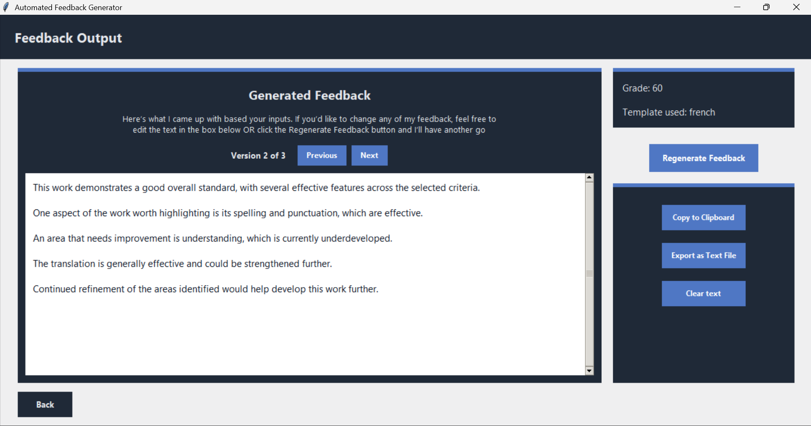
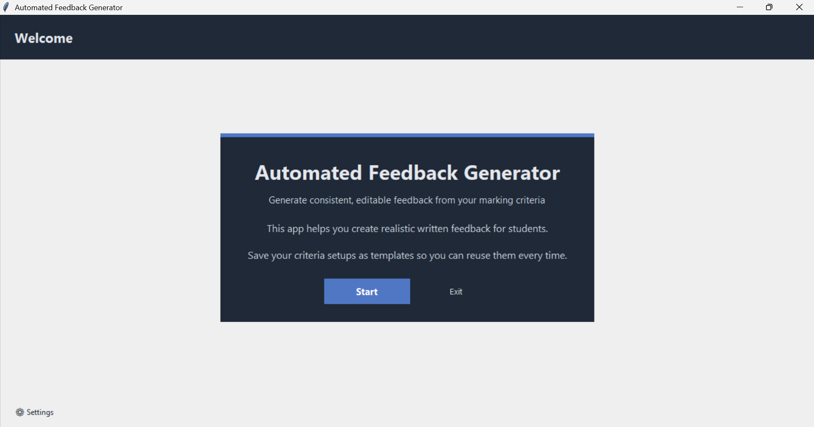
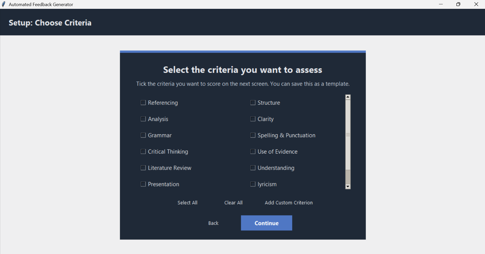
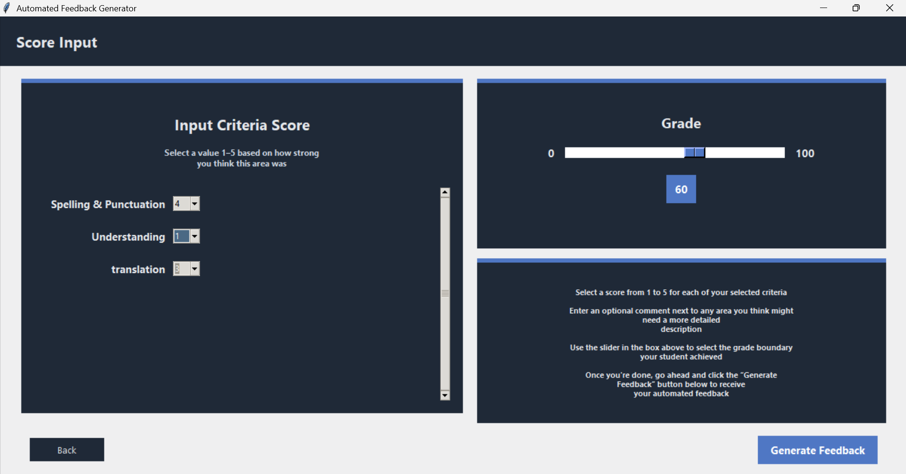

# Automated Feedback Generator

A desktop application that uses a rule-based system to generate multiple peices of assessment feedback based on a user's custom marking criteria. 
Built using **Python** and **Tkinter** as a final-year BSc (Hons) Computer Science dissertation project at Liverpool John Moores University (**75%**).

> **Purpose:** Help educators more quickly work up feedback drafts. The application does **not** mark submissions, calculate grades or use a language model.

## Features

- **Customisable assessment criteria:** Choose built-in criteria or add your own.
- **Reusable templates:** Save and reopen sets of assessment criteria.
- **Score-based feedback:** Assign each selected criterion a score from 1 to 5 and select an overall grade boundary.
- **Alternative drafts:** Generate up to three different versions of the feedback, then navigate between them or regenerate them.
- **Editable results:** Revise the text, copy it to the clipboard or export it as a `.txt` file.
- **Vocabulary settings:** Add words and phrases to the feedback engine's vocabulary libraries.
- **Local persistence:** Store templates, custom criteria and vocabulary in JSON.
- **Automated unit tests:** Run regression checks for the feedback engine and JSON persistence without opening the GUI.

## Screenshots

**Generated feedback** — view three alternative drafts, edit the wording, and copy or export the result.



<details>
<summary><strong>Explore the other screens (home, template configuration and scoring)</strong></summary>

### Home screen



### Assessment template configuration



### Criterion scoring



</details>

## How it works

The application uses a **rule-based feedback engine**, not machine learning or AI-generated text.

1. The user chooses assessment criteria and scores them on a five-point scale.
2. The user selects an overall grade boundary from 0 to 100 in steps of 10. The grade determines the overall tone of the response to maintain tonal consistency across comments.
3. If more than three criteria are provided, the engine prioritises the **two lowest-scoring criteria and one highest-scoring criterion**; otherwise, it uses all selected criteria.
4. Sentence frames and adjective libraries are combined to create written feedback. Phrasing is **randomly varied** between drafts, while the scoring and selection rules remain fixed.
5. The user reviews and edits the resulting drafts before using or exporting them.

The current interface supports an optional additional comment for the **Analysis** criterion.

## Requirements

- Python **3.9+**
- Tkinter, included with many standard Python installations (on some Linux distributions, install the separate `python3-tk` package)
- A desktop environment capable of displaying a graphical application

The project uses only Python standard-library modules; there is no `pip` installation step.

## Run locally

1. Download or clone the repository.
2. Open a terminal in the project directory.
3. Run:

   ```bash
   python main.py
   ```

   On some systems, use `python3` instead of `python`.

4. Select **Start** to create or load an assessment template. Choose criteria, assign scores and a grade boundary, then select **Generate Feedback**.

No external Python packages or network services are required. The application stores all user data locally.

## Run the automated tests

From the project root, run:

```bash
python -m unittest discover -s tests -v
```

The test suite uses only the Python standard library with no additional packages required. Its **34 unit tests** cover input validation, grade and score banding, priority criterion selection, phrase-library behaviour, feedback generation, and JSON loading/saving, including invalid input and malformed files.

The tests are deliberately independent of Tkinter so they can run in a terminal or in continuous integration without opening a desktop window. A workflow in `.github/workflows/tests.yml` is configured to run them on pushes and pull requests **after this project is published to GitHub**. The tests do not yet automate GUI interactions, and passing tests do not mean every user-facing issue has been fixed.

## Project files

```text
automated-feedback-generator/
├── main.py                         # Launch the Tkinter application
├── feedback_generator/
│   ├── controller.py              # App controller, shared state and navigation
│   ├── engine.py                  # Rule-based feedback generation
│   ├── storage.py                 # JSON template loading and saving
│   └── gui/
│       ├── home.py
│       ├── settings.py
│       ├── template_selection.py
│       ├── template_setup.py
│       ├── scoring.py
│       └── output.py
├── tests/
│   ├── test_engine.py              # Unit tests for validation and generation
│   └── test_storage.py             # Unit tests for JSON persistence
├── .github/workflows/tests.yml     # Run the test suite on GitHub
├── screenshots/                     # GUI screenshots featured above
├── setup_templates.example.json    # Example configuration structure
├── REFACTOR_NOTES.md              # Record of structural refactor
├── .gitignore                     # Local data and development files excluded from Git
└── README.md
```

When you save templates or custom vocabulary, the application writes `setup_templates.json` in the project root, beside `main.py`. This is local user data and is ignored by Git; do not commit it to a public repository. The included `setup_templates.example.json` shows the file format. If `setup_templates.json` is missing, the application starts without saved templates and creates it when changes are saved.

## Design and implementation

- **Application controller (`feedback_generator/controller.py`):** Manages shared state, GUI navigation, and user-triggered application actions.
- **Multi-page Tkinter GUI (`feedback_generator/gui/`):** Six independently defined view classes for the home screen, saved templates, template setup, scoring, feedback output and settings.
- **Rule-based feedback engine (`feedback_generator/engine.py`):** Validates inputs, assigns score bands, selects relevant criteria and assembles feedback from sentence frames without importing Tkinter.
- **JSON persistence (`feedback_generator/storage.py`):** Loads and saves reusable assessment templates, user-defined criteria and custom vocabulary without importing Tkinter.
- **Version navigation:** Stores generated alternatives in application state for viewing and editing.

## Refactoring notes

This repository contains a **structural refactor** of the original dissertation code: the monolithic Python file was split into modules while preserving its existing interface and feedback-generation behaviour. The initial refactor preserved behaviour. A subsequent targeted change corrected sentence-frame grammar (including phrases such as "excellent" and "clear in places") and the plural agreement for the built-in **Spelling & Punctuation** criterion. The application still generates **three** drafts, and its selection rules, randomised wording, and optional-comment behaviour are unchanged. Keep the original university submission separately as an archive.

## Current limitations and possible improvements

- The feedback is assembled from predefined language templates and may require editing before use.
- Phrasing varies randomly; identical inputs do not guarantee identical wording.
- The number of **unique** drafts may be fewer than three for some inputs.
- Additional comments are currently supported only for the Analysis criterion.
- Returning to the scoring screen resets the displayed scores and grade boundary; re-enter values before regenerating.
- Edits made to an individual feedback draft are not retained when switching between versions. Copy or export your edits before navigating away.
- Core feedback-generation and storage logic has unit tests, but GUI interactions are not yet covered by automated tests.

## Academic context

This project was developed as a final-year university dissertation and awarded **75% (First-Class)**.

## Author

**Matthew Dodson** — First-Class BSc (Hons) Computer Science graduate, Liverpool John Moores University.
